<!---
White-GH05T/White-GH05T is a ✨ special ✨ repository because its `README.md` (this file) appears on your GitHub profile.
Glass visuals live in /assets (SVG). Edit them there.
--->

<a href="https://www.abdrahman.in"></a>




<a href="https://www.housekeepingco.com/"></a>
<a href="https://www.talentmate.com/"></a>
<a href="https://whatsappdev.housekeepingco.com/"></a>
<a href="https://www.caresoftglobal.com/cornea/"></a>

<b>🗂️ View all 14 projects</b> · <i>Laravel, Django, React, Angular, Flutter & Next.js</i>

 

| Project | Stack | What it does |
|---|---|---|
| [HousekeepingCo](https://www.housekeepingco.com/) | Laravel · Flutter | Live-in maid & nanny hiring with visa sponsorship |
| [Talentmate](https://www.talentmate.com/) | Laravel | UAE job portal: CVs, applications, employers |
| [My Poppin](https://www.mypoppin.com/) | Laravel | Connects families with verified caregivers |
| [Domesticworker](https://www.domesticworker.ae/) | Laravel | MoHRE-approved recruitment & visa processing |
| [Acoup](https://www.acoup.com/) | Laravel | Licensed BPO & ethical recruitment platform |
| [Acoup Callcenter](https://assist.acouptraining.com/) | Django | Call tracking & customer support platform |
| [Acoup CEFR](https://cefr.acouptraining.com/) | Django | Online English test with CEFR certification in 2 hours |
| Acoup LMS | Flutter | Learning platform for Acoup courses |
| [WhatsApp MetaConnect](https://whatsappdev.housekeepingco.com/) | React | Business WhatsApp messaging dashboard |
| [FYNTH](https://www.fynth.com/) | React | Employee promotions & increments management |
| [Caresoft](https://www.caresoftglobal.com/) | Angular | Engineering insights & cost-reduction tools |
| [Iceberg](https://www.caresoftglobal.com/iceberg/) | Angular | Enterprise vehicle benchmarking platform |
| [Cornea](https://www.caresoftglobal.com/cornea/) | Angular | 360° VR vehicle inspection |
| [Veztyle Fashion](https://www.veztyle.com/) | Next.js | Custom T-shirt e-commerce store |

<a href="https://www.abdrahman.in/projects">See them on my portfolio ↗</a>


<b>💼 Full experience details</b> · <i>click to expand</i>

 

**Frontend Developer** · Housekeeping Co, Dubai &nbsp;Nov 2021 – Present
 Designing and building responsive web and mobile apps with cross-functional teams. `React` `Flutter` `NestJS` `REST APIs` `UI/UX`

**Web Developer** · Telecomatics, Coimbatore &nbsp;Jan 2021 – Sep 2021
 Full-stack development, API integrations, database management and performance optimization. `Node.js` `Express` `APIs`

**Software Engineer** · Caresoft Global, Coimbatore &nbsp;Aug 2019 – Sep 2020
 Full-stack web applications with a focus on API design and databases. `MySQL` `MongoDB` `APIs`

**AR/VR Designer → Intern** · Caresoft Global &nbsp;Nov 2018 – Jul 2019
 Interactive 3D models and immersive virtual environments in Unity. `Unity` `AR/VR` `3D`

**Unity Developer** · Freelance &nbsp;Jun 2018 – Sep 2019
 AR/VR experiences and interior-design simulations for retail clients. `Unity` `Simulation`

**Frontend Developer** · Artist United &nbsp;Jul 2016 – Mar 2017
 Interactive, client-focused websites. `HTML` `CSS` `JavaScript`


 

 

  



  

<b>📅 Contribution chart</b>  

  

<picture>
  <source media="(prefers-color-scheme: dark)" srcset="https://raw.githubusercontent.com/White-GH05T/White-GH05T/output/github-snake-dark.svg" />
  
</picture>


<a href="https://www.abdrahman.in/contact"></a>

